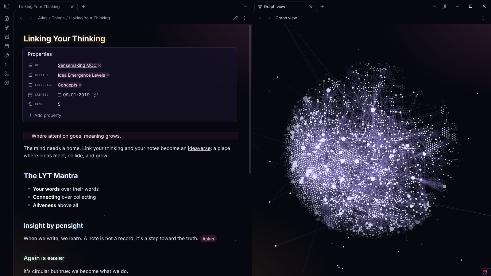

# Starfield

An Obsidian theme for working among the stars.

Deep space, a nebula glow in the corners, and pink for the chrome. Headings catch a little starlight at their edges: the title and H1 gold, H2 purple, H3 blue, H4 green, H5 pink. H6 is a small-caps label, like an instrument on a starship. Properties sit in a dark panel with small mono labels, and the graph view becomes a galaxy.

Starfield is a night sky, so it stays dark in both of Obsidian's modes.

## Made with Maps of the Ideaverse

Starfield grew out of [Maps of the Ideaverse](https://github.com/nickmilo/ideaverse-maps), whose Starfield and Starship maps fly you through your notes. With that plugin installed, links can also be colored by how their notes relate (by Idea Emergence): up gold, related purple, above blue, below green, other properties slate.

## Install

Settings → Appearance → Themes → Manage → search for **Starfield**.

By [Nick Milo](https://linkingyourthinking.com).
